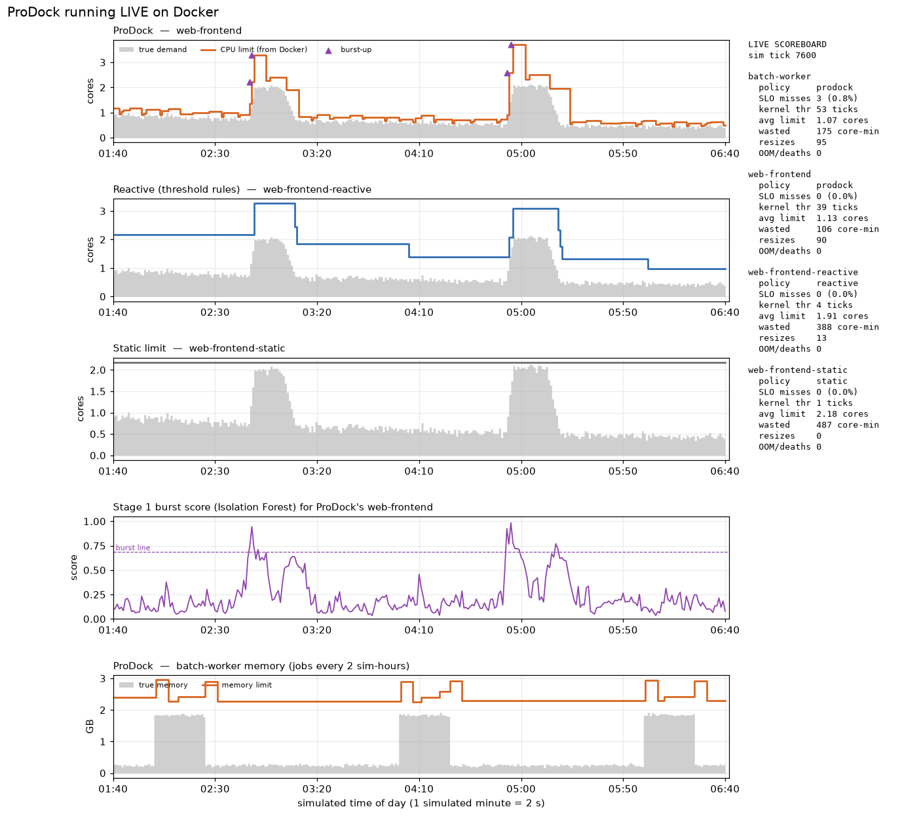

# ProDock: proactive AI resource allocation for standalone Docker containers

ProDock watches Docker containers, **predicts** how much CPU and memory each one will need over
the next 3 minutes, and resizes their limits with `docker update` **before** the demand arrives:
no restart, no Kubernetes.

```
docker stats ─► features ─► Isolation Forest (burst score) ─► LSTM (peak forecast) ─► allocator ─► docker update
   (L1)           (L2)            (Stage 1)                       (Stage 2)              (L3)          (L4)
      ▲                                                                                                │
      └───────────────────────────── new limits take effect on the next tick ◄──────────────────────────┘
```

Base paper: **ConLAR** (Chen, Shen, Chen, IEEE QRS 2021). ProDock adds a burst detector borrowed
from **ExtremoNet** (Wang & Wang, 2024), plus anti-thrashing and memory-safety rules in the
spirit of **DeepScaling** (Wang et al., 2024).

There are two ways to see it work:

| | What it is | Needs Docker? | Time |
|---|---|---|---|
| **Simulated evaluation** | 4 containers × 7 days of per-minute data. Trains on days 1–5, then replays days 6–7 under 4 allocation policies and draws every graph. | No | ~10 min |
| **Live demo** | Real containers burn real CPU/memory. The Linux kernel really throttles or OOM-kills them, and ProDock really resizes them. | Yes | ~13 min |

---

## 1. Requirements

- **Python 3.12** (3.10+ should work)
- **Docker Desktop**, only for the live demo. On Windows/Mac it must show **"Engine running"**.
  On Linux, Docker Engine with the compose plugin.
- About 8 free CPU cores and 6 GB of free RAM for the live demo. It really burns that much at
  peak, so close heavy apps and keep a laptop plugged in.

## 2. Install

```bash
git clone https://github.com/georgedotdev/os-project.git
cd os-project/prodock
python -m pip install -r requirements.txt
```

**Every command below runs from the `prodock/` folder.**

## 3. Check that it works (10 seconds)

```bash
python tests/test_core.py
```

You should see 3 lines starting with `PASS`: the LSTM's hand-written backpropagation matches a
numerical gradient, features never look into the future, and the allocator keeps limits inside
the caps.

## 4. Simulated evaluation (no Docker needed)

```bash
python run_experiment.py          # add --quick for a 1-minute smoke run (3 epochs)
```

This regenerates the 7-day workload, trains the Isolation Forest + LSTM, compares the 4 policies,
and writes `results/` (tables) and `figures/` (9 graphs). It also rebuilds
`models/prodock_pipeline.pkl`. **Run this first if loading the model ever fails.** That happens
with a different scikit-learn version. The fixed seed (7) means everyone gets the same numbers.

Terminal replay of ProDock making decisions on the test days (still no Docker):

```bash
python run_demo.py                # 300 simulated minutes, 20 per second
```

## 5. Live demo on real Docker

Open **two terminals** in `prodock/`.

**Terminal 1: start the containers, then ProDock:**

```bash
python demo/demo.py up --minutes 12
python run_live.py --demo --apply
```

**Terminal 2: the live chart:**

```bash
python demo/dashboard.py
```

`run_live.py` stops on its own when the 12 minutes are up and prints a scoreboard. Ctrl+C stops it
early and still prints the scoreboard. Then clean up:

```bash
python demo/demo.py down
```

### What you are looking at

`demo.py up` starts four containers. Each one runs a tiny load generator
(`demo/loadgen/burn.py`) that replays a slice of the simulated workload. It **actually spins that
many CPU cores and holds that much memory**:

| Container | Load | Who controls its limits |
|---|---|---|
| `web-frontend` | web traffic with flash crowds | **ProDock** |
| `web-frontend-reactive` | the identical load | threshold rules (>80% used → ×1.5, <30% → ×0.75) |
| `web-frontend-static` | the identical load | nobody: fixed limit, like most deployments |
| `batch-worker` | a job every 2 simulated hours | **ProDock** |

- **Time is compressed: 1 simulated minute = 2 real seconds.** ProDock takes one reading per
  simulated minute, the exact time scale the model was trained on. So 12 real minutes cover 6
  hours, with 2 flash crowds and 3 batch jobs.
- **ProDock never sees the replayed workload.** It only sees what `docker stats` reports. The
  workload is used afterwards, only to score misses.
- **Watch for:** the purple burst score crossing its line as each flash crowd starts, `burst-up`
  in terminal 1, and the orange limit jumping *before* the grey demand peaks. Meanwhile the
  static container wastes a wide band of CPU, and the reactive one jumps late and stays high.
- **Want Docker's own proof?** In a third terminal, run
  `docker stats web-frontend web-frontend-reactive web-frontend-static batch-worker` and watch
  the CPU limits change live.

Options: `demo.py up --tick 1` (twice as fast), `--no-batch` (fewer cores), `--minutes N`.
`python run_live.py --demo --check` tests the Docker connection and the containers.
`python demo/dashboard.py --snapshot results/live_demo.png` saves the chart as an image.
A minute-by-minute presenter script is in [`prodock/demo/README.md`](prodock/demo/README.md).

### Troubleshooting

| Problem | Fix |
|---|---|
| `cannot talk to Docker` / `failed to connect to the docker API` | Start Docker Desktop and wait for "Engine running". It sometimes closes on first launch; start it again. |
| `container name "/web-frontend" is already in use` | An old container has that name: `docker rm -f web-frontend` (and the same for the others). |
| `sampling took too long, skipping` | The machine is overloaded. Use `demo.py up --tick 3`, or `--no-batch`. |
| Error loading `prodock_pipeline.pkl` | Different scikit-learn version: run `python run_experiment.py` once. |
| `ModuleNotFoundError: docker` | `python -m pip install -r requirements.txt` |

---

## 6. Results

### Simulated evaluation (test days 6–7, all 4 containers)

| Policy | SLO violations | Wasted CPU (core-h) | OOM kills | Limit changes |
|---|---|---|---|---|
| Static | 1.28% | 246.5 | 0 | 0 |
| Reactive | 2.14% | 122.8 | 24 | 1,206 |
| Predictive (ConLAR-style) | 2.48% | 34.9 | 93 | 11,473 |
| **ProDock** | **0.70%** | 54.3 | **1** | 1,966 |

### Live demo on Docker (rehearsal, 362 ticks = 6 simulated hours, the same load for all three web containers)

| Container | Controlled by | SLO misses | Avg CPU limit | Wasted (core-min) | Resizes | OOM kills |
|---|---|---|---|---|---|---|
| web-frontend | **ProDock** | 0 | 1.13 cores | **106** | 90 | 0 |
| web-frontend-reactive | threshold rules | 0 | 1.91 cores | 388 | 13 | 0 |
| web-frontend-static | fixed limit | 0 | 2.18 cores | 487 | 0 | 0 |
| batch-worker | **ProDock** | 3 (0.8%) | 1.07 cores | 175 | 95 | 0 |

On the same live load, ProDock reserved **78% less CPU than the fixed limit and 73% less than the
reactive rules**, with no SLO misses. Because it runs closer to the limit, the kernel's CFS
scheduler throttled ProDock's container in 39 of 362 ticks (≥10% of 100 ms periods), against 1 for
the fixed limit. That is the honest price of the savings. The 3 `batch-worker` misses are the
first minute of a scheduled job; see Limitations.



## 7. Limitations

- The workload is **simulated**. The live demo runs it on real containers and a real kernel, but
  it is not production traffic.
- **Scheduled jobs** are seen one tick late: the job runs every 2 hours, but the LSTM looks back
  30 minutes. A "same time yesterday" feature would fix this.
- ProDock needs **40 ticks of history** before its first decision. The live demo starts during a
  batch job so the memory floor learns a job's size during warm-up. Start between jobs instead
  (`demo.py up --start 7300`) and the first job gets OOM-killed. That is a real cold-start
  limitation.
- The model only knows the 4 container names it was trained on. Running it on other workloads
  needs recording (`run_live.py --record file.csv`) and a retraining script (not written yet).

## 8. Repository layout

| Path | What it is |
|---|---|
| `prodock/prodock/` | The system: `workload.py` (simulated host), `features.py` (L2), `burst.py` (Stage 1), `lstm.py` (Stage 2, NumPy), `pipeline.py`, `allocator.py` (L3, 4 policies), `docker_io.py` (L1 collector + L4 executor), `evaluate.py`, `store.py` (SQLite logs) |
| `prodock/run_experiment.py` | Simulated evaluation: trains, scores, draws all figures |
| `prodock/run_demo.py` | Terminal replay of the simulation |
| `prodock/run_live.py` | ProDock on real Docker (`--demo` follows the demo clock) |
| `prodock/demo/` | Live demo: `demo.py` (up/down), `docker-compose.yml`, `loadgen/burn.py`, `dashboard.py`, presenter guide |
| `prodock/models/` | Trained pipeline (Isolation Forests + LSTM) |
| `prodock/results/`, `prodock/figures/` | Tables, logs and the 9 graphs from the simulation, plus the live rehearsal record |
| `prodock/docs/` | Architecture diagram and the script that draws it |
| `AI_Docker_Resource_Allocation_Review_with_ProDock.docx` | The review paper |
| `ProDock_Project_Rundown.md` / `.pdf` | Plain-English guide for presenting, with likely questions |
| `TASKLIST.md` | What is done and what is still open |
