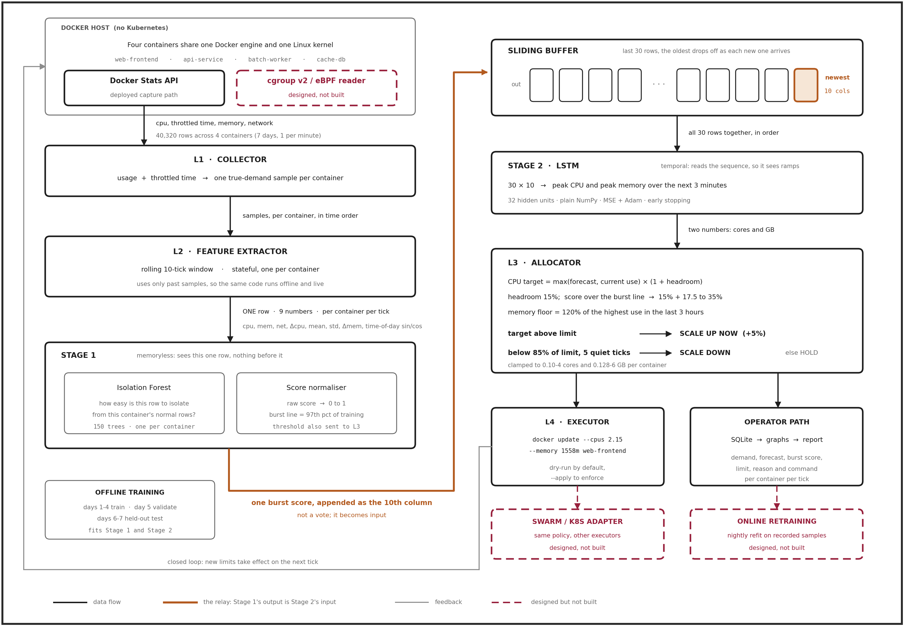

# ProDock: proactive AI resource allocation for standalone Docker containers

ProDock watches Docker containers, predicts how much CPU and memory each one will need in the
next few minutes, and resizes their limits with `docker update` before the demand arrives.

Base paper: **ConLAR** (Chen, Shen, Chen, IEEE QRS 2021), an Observe, Predict, Allocate, Execute
loop with an LSTM for Docker containers. ProDock adds a burst detector borrowed from
**ExtremoNet** (Wang & Wang, Applied Sciences 2024) and anti-thrashing rules in the spirit of
**DeepScaling** (Wang et al., IEEE/ACM ToN 2024).



## Quick start

```bash
pip install -r requirements.txt
python tests/test_core.py        # 3 checks, including an LSTM gradient check
python run_experiment.py         # ~10 min on a laptop: trains, evaluates, writes results/ and figures/
python run_demo.py               # live terminal replay of ProDock making decisions
```

Live demo on real Docker (needs Docker Desktop running; full guide in `demo/README.md`):

```bash
python demo/demo.py up --minutes 12        # 4 trace-driven containers, 1 sim-minute = 2 s
python run_live.py --demo --apply          # ProDock + a reactive baseline really resize them
python demo/dashboard.py                   # live chart (second terminal)
python demo/demo.py down
```

See the README one level up for the full run guide, troubleshooting and the live results.

## Layout

| Path | What it is |
|---|---|
| `prodock/workload.py` | Simulated Docker host: 4 containers, 7 days, 1 row per minute |
| `prodock/docker_io.py` | L1 collector (`docker stats`) and L4 executor (`docker update`) |
| `prodock/features.py` | L2 feature extractor (9 numbers per container per tick) |
| `prodock/burst.py` | Stage 1: Isolation Forest burst score |
| `prodock/lstm.py` | Stage 2: LSTM written in NumPy, with hand-written backprop |
| `prodock/pipeline.py` | Joins L2, Stage 1 and Stage 2; save/load |
| `prodock/allocator.py` | L3: Static, Reactive, Predictive (ConLAR-style) and ProDock policies |
| `prodock/evaluate.py` | Forecast metrics and closed-loop replay of the test days |
| `prodock/store.py` | SQLite decision log (operator path) |
| `run_live.py` | Runs ProDock on real Docker (`--demo` follows the demo's shared clock) |
| `demo/` | Live demo: `demo.py` up/down, `docker-compose.yml`, `loadgen/burn.py`, `dashboard.py` |
| `docs/draw_architecture.py` | Regenerates the architecture diagram |

## Results (test days 6 and 7, all 4 containers)

| Policy | SLO violations % | Wasted CPU (core-h) | Avg CPU util % | OOM kills | Limit changes |
|---|---|---|---|---|---|
| Static | 1.28 | 246.5 | 41.6 | 0 | 0 |
| Reactive | 2.14 | 122.8 | 50.7 | 24 | 1206 |
| Predictive (ConLAR-style) | 2.48 | 34.9 | 73.0 | 93 | 11473 |
| **ProDock** | **0.70** | 54.3 | 65.4 | **1** | 1966 |

Data is simulated, so these numbers show the method works as designed, not how it performs in
production. See `results/` for every table and `figures/` for every graph.
